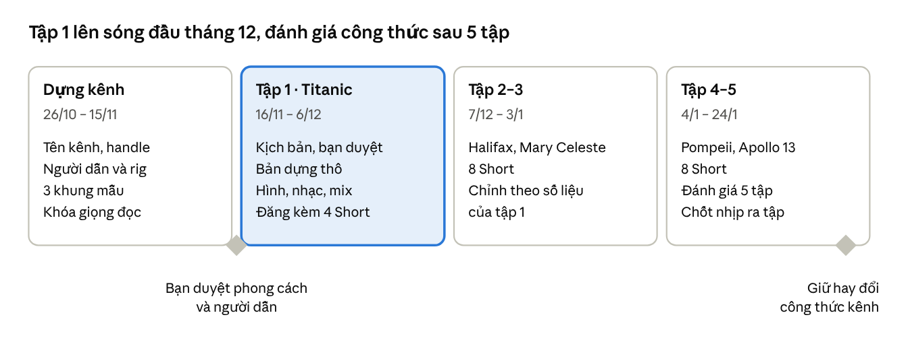

# Kế hoạch kênh lịch sử motion

2026-10-20

## Tóm tắt kênh

Kênh kể chuyện lịch sử bằng tiếng Anh, làm hoàn toàn bằng motion graphics dựng bằng code, với **một người dẫn cố định hóa thân vào một người bình thường có mặt trong mỗi sự kiện**. Lời hứa với người xem: *phần lịch sử mà sách và phim bỏ qua, kể bởi người đã đứng ở đó*.

- **Khán giả:** người xem quốc tế nói tiếng Anh, 18–44 tuổi, thích lịch sử, phim tài liệu và chuyện có thật; xem trên YouTube máy tính, TV và Shorts trên điện thoại.
- **Đề tài:** lịch sử nói chung, không chỉ thảm họa: sự kiện nổi tiếng nhìn từ góc ít người kể, người hùng vô danh, bí ẩn và những con số bị quên.
- **Điểm khác biệt:** các kênh lịch sử hoạt hình lớn (Kurzgesagt, Simple History, The Infographics Show, OverSimplified) giữ cố định giọng đọc và nét vẽ, nhưng không kênh nào có một người dẫn hoạt hình hiện hình cố định. Đây là chỗ trống để chiếm, nhưng chưa ai chứng minh nó thành công, nên 5 tập đầu là để thử.
- **Cách làm:** mỗi tập dựng bằng code (Claude Code viết trang `render(t)` hoặc Remotion), giọng TTS tiếng Anh, nhạc và tiếng động tự dựng, ghép cuối trong CapCut. Không dùng video AI.

## Tên kênh và nhận diện

Mình đề xuất tên **Footnote**: những chuyện lịch sử nằm ở chú thích cuối trang, đúng lời hứa của kênh. Cần kiểm trên YouTube xem tên và handle còn trống không trước khi chốt.

| Tên | Khẩu hiệu | Ý nghĩa | Điểm yếu |
| --- | --- | --- | --- |
| Footnote (đề xuất) | History, from the people in the footnotes. | Chuyện ở chú thích, người bình thường | Từ phổ biến, dễ trùng |
| One Who Was There | Every story has a witness. | Người dẫn luôn là người có mặt | Dài, khó làm logo |
| The Unwritten | What the history books left out. | Phần chưa được viết | Nghe hơi bí ẩn, hợp tập bí ẩn hơn tập người hùng |
| Small Witness | Big history, seen up close. | Nhìn sự kiện lớn qua mắt một người | Chữ "small" có thể làm kênh nghe nhỏ |

Nhận diện giữ cố định qua mọi tập:

- **Thumbnail:** mặt người dẫn đang phản ứng (to, bên trái), một đồ vật của sự kiện (bên phải), tối đa 3 chữ. Nền theo màu chủ đạo của tập.
- **Mở đầu:** không có intro dài. Sau câu móc, logo hiện 2 giây bằng động tác riêng của kênh: người dẫn bước qua một trang giấy vào cảnh.
- **Dấu chú thích:** mỗi chi tiết chưa kể hiện kèm một số chú thích nhỏ màu nhấn (¹ ² ³), cuối tập đọc lại nguồn. Đây là móc hình dễ nhớ nhất của kênh.
- **Âm thanh:** một tiếng hiệu ngắn cố định (tiếng bút đánh dấu chú thích) dùng ở mọi tập.

## Người dẫn chuyện

Người dẫn là một nhân vật motion cố định, tạm gọi **the Witness**. Mỗi tập, nhân vật này khoác trang phục của một người bình thường có mặt trong sự kiện, nhưng khuôn mặt, dáng người và giọng không đổi, nên khán giả nhận ra ngay.

- **Thiết kế:** khối đơn giản, bóng dáng nhận ra ở cỡ ảnh thu nhỏ: mái tóc một khối, khăn quàng cổ màu nhấn (giữ qua mọi trang phục), túi đeo chéo đựng sổ ghi chép. Mỗi bộ phận một lớp để rig.
- **Bộ rig cần có:** 5 tư thế đầu, 9 hình miệng × 2 biến thể (thường, buồn), 5 kiểu mày, 4 kiểu mắt, 5 bàn tay. Trang phục từng tập chỉ là một lớp áo, mũ đổi thêm.
- **Tính cách:** tò mò, trầm, tôn trọng người trong chuyện. Đùa khô ở tập nhẹ, không bao giờ đùa gần cái chết.
- **Cách hóa thân:** mở tập bằng một câu ngôi thứ nhất, ví dụ *"April 1912. I'm a steward in third class. I've counted the lifeboats."* Giữa tập, người dẫn có thể bước ra khỏi vai để nói con số hoặc điều người lúc đó chưa biết, rồi bước vào lại. Vai hóa thân luôn là nhân vật hư cấu, ghi rõ ở cuối tập. Không bao giờ đặt câu bịa vào miệng người có thật.
- **Giọng:** một giọng TTS tiếng Anh duy nhất cho cả kênh, khóa ID giọng từ tập 1. Ứng viên: ElevenLabs (điều khiển cảm xúc bằng tag như `[sad]`, `[whispers]`) hoặc Kokoro (miễn phí, chạy trên máy, ít cảm xúc hơn). Giọng cố định là thứ các kênh lớn giữ lâu nhất.
- **Luật diễn:** không bao giờ đứng yên hẳn (thở, chớp mắt, đầu trôi nhẹ); mỗi đoạn ít nhất một phản ứng với hình lịch sử (nhìn sang, khựng lại, im); cử chỉ rơi vào từ nhấn. Chi tiết nằm trong bộ key "Narrator rig & acting" của báo cáo *Key kể chuyện bằng motion*.

## Phong cách hình và âm thanh

Nền chung là motion 2D phẳng, hình khối đơn giản, vân giấy nhẹ, mỗi tập tối đa 5 màu cộng một màu nhấn dành riêng cho chi tiết chưa kể. Phong cách cụ thể sẽ chốt bằng 3 khung mẫu trước tập 1.

**Ngữ pháp chuyển động của kênh** (viết một lần, dùng mọi tập; chỉ phá luật có chủ đích ở cú lật truyện):

- Trái sang phải là thời gian tiến lên; ngược lại là hồi tưởng.
- Dữ kiện đi vào như một tấm thẻ đóng dấu chú thích, trượt lên từ dưới.
- Con số lớn là lưới hình người cùng cỡ, đếm từng hàng theo lời đọc; mất mát là hình chuyển xám rồi rơi khỏi hàng. Không vẽ cảnh chết.
- Chuyển cảnh mang nghĩa: hình này biến thành hình kia = "trở thành"; khớp hình = "giống như"; một cú máy liền = "cùng một dòng thời gian"; cắt thẳng = "có gì đó vỡ".
- Mỗi lần lộ quy mô luôn có một hình người làm mốc.

**Màu theo loại tập:**

| Loại tập | Màu nền | Đường màu qua tập | Màu nhấn |
| --- | --- | --- | --- |
| Thảm họa | Xanh xám lạnh | Ấm lúc mở đầu, giảm bão hòa dần tới cao trào, hồng nhạt lúc kết | Đỏ pháo hiệu |
| Người hùng vô danh | Vàng ấm | Tối ở khó khăn, sáng dần tới kết | Cam |
| Bí ẩn | Xanh lục đậm, tím | Tối đều, lóe sáng ở mỗi manh mối | Xanh ngọc |
| Con số | Giấy trắng ngà, mực đen | Gần như đơn sắc | Đỏ |

**Âm thanh:**

- **Nhạc thảm họa:** không giai điệu. Âm trầm kéo dài (drone), nhịp đập trầm như tim, dây trầm trượt xuống, hợp âm nghịch tai; rút hẳn nhạc khi con số nặng nhất được nói.
- **Nhạc tập nhẹ:** đàn gảy, bộ gõ nhỏ, piano mềm.
- **Mix:** nhạc thấp hơn giọng 12–20 dB, tự hạ thêm khi có lời; tiếng động và tiếng nền đặt thấp hơn giọng hẳn; xuất −14 LUFS, đỉnh −1 dBTP; nghe thử trên loa điện thoại.

## Trụ cột nội dung và định dạng

Kênh có bốn trụ cột. Tập chính là xương sống; Shorts cắt ra từ tập chính để kéo người xem mới.

| Trụ cột | Nội dung | Độ dài | Tỉ lệ tập chính |
| --- | --- | --- | --- |
| Untold | Sự kiện nổi tiếng, nhìn từ góc ít người kể | 7–9 phút | 50% |
| Unsung | Một người bình thường làm nên khác biệt mà ít ai nhớ tên | 6–8 phút | 25% |
| Unsolved | Bí ẩn, hoặc huyền thoại so với sự thật | 6–8 phút | 25% |
| By the Numbers | Một con số được đếm lại bằng lưới hình người | 45 giây – 3 phút | Shorts và tập ngắn |

- **Shorts:** mỗi tập chính cắt ra 3–4 Short 45–60 giây, khung dọc 1080×1920, mỗi Short một chi tiết chưa kể. Dựng từ cùng mã nguồn, chỉ đổi khung hình.
- **Độ dài tập chính:** 7–9 phút, khoảng 950–1.250 từ tiếng Anh (đọc 130–140 từ/phút). Dài hơn thì thời gian dựng tăng theo.

## 30 tập đầu

30 tập gồm 10 Untold, 10 Unsung, 8 Unsolved và 2 By the Numbers, xen kẽ tập nặng và tập nhẹ để kênh không chỉ là kênh thảm họa. Góc kể dưới đây là đề xuất: mọi dữ kiện sẽ kiểm nguồn và ghi FACTS trước khi viết kịch bản từng tập. Vai hóa thân luôn là nhân vật hư cấu, kể cả khi tập nói về người có thật.

| # | Sự kiện | Trụ cột | Người dẫn hóa thân | Góc chưa kể |
| --- | --- | --- | --- | --- |
| 1 | Titanic, 1912 | Untold | Tiếp viên hạng ba | Xuồng thiếu chỗ, xuồng đầu rời đi nửa trống, tàu Californian tắt điện đài |
| 2 | Halifax, 1917 | Unsung | Nhân viên nhà ga | Người điều phối tàu ở lại đánh điện báo dừng tàu khách trước vụ nổ |
| 3 | Con tàu Mary Celeste, 1872 | Unsolved | Thủy thủ tàu tìm thấy nó | Tàu trôi dạt còn nguyên hàng, không một ai |
| 4 | Pompeii, năm 79 | Untold | Thủy thủ trong đoàn tàu của Pliny Già | Chuyến tàu cứu hộ đi ngược về phía núi lửa |
| 5 | Apollo 13, 1970 | Unsung | Kỹ sư mặt đất | Đội dưới đất ghép bộ lọc khí từ đồ có sẵn trên tàu |
| 6 | Thành Troy | Unsolved | Người đào khảo cổ | Thành có thật không, và có bao nhiêu tầng thành chồng lên nhau |
| 7 | Chernobyl, 1986 | Untold | Công nhân dọn dẹp | Những người dọn dẹp sau đêm nổ, không phải đêm nổ |
| 8 | Đình chiến Giáng sinh, 1914 | Unsung | Lính bộ binh | Hai chiến tuyến tự ngừng bắn mà không ai ra lệnh |
| 9 | Krakatoa, 1883 | Untold | Nhân viên điện báo | Tiếng nổ nghe thấy từ hàng nghìn km |
| 10 | Dunkirk, 1940 | Unsung | Chủ một chiếc thuyền nhỏ dân sự | Đoàn "tàu nhỏ" của dân thường |
| 11 | Tunguska, 1908 | Unsolved | Người chăn tuần lộc | Một vụ nổ san phẳng rừng mà không để lại hố |
| 12 | Lũ mật mía Boston, 1919 | Untold | Công nhân bến cảng | Một con sóng mật đường giữa phố |
| 13 | Shackleton và tàu Endurance, 1914–1917 | Unsung | Thủy thủ trong đoàn | Những người ở lại trên đảo chờ cứu |
| 14 | Thư viện Alexandria | Unsolved | Người chép sách | Thư viện không cháy trong một đêm |
| 15 | Đại dịch cúm 1918 | By the Numbers | Y tá | Con số người chết so với Thế chiến I |
| 16 | Hindenburg, 1937 | Untold | Thành viên đội mặt đất | Vì sao phần lớn người trên tàu sống sót |
| 17 | Everest, 1953 | Unsung | Người khuân vác | Người Sherpa trong lần lên đỉnh đầu tiên |
| 18 | Khiêu vũ dịch bệnh Strasbourg, 1518 | Unsolved | Người dân trong phố | Cả phố nhảy mà không dừng được |
| 19 | Tàu Vasa, 1628 | Untold | Thợ đóng tàu | Con tàu chìm sau vài phút của chuyến đầu tiên |
| 20 | Thợ mỏ Chile, 2010 | Unsung | Thợ khoan cứu hộ | Những ngày đầu khi chưa ai biết họ còn sống |
| 21 | Thermopylae, 480 TCN | Unsolved | Lính Hy Lạp không phải Sparta | "300" thật ra không chỉ có 300 |
| 22 | Cầu Tacoma Narrows, 1940 | Untold | Kỹ sư cầu đường | Cây cầu uốn như sóng trước khi sập |
| 23 | Hang Tham Luang, 2018 | Unsung | Nông dân trồng lúa | Những người chịu cho nước bơm ra ngập ruộng |
| 24 | Cái chết đen, 1347 | By the Numbers | Người đào huyệt | Một phần châu Âu biến mất |
| 25 | Đám cháy Chicago, 1871 | Unsolved | Lính cứu hỏa | Huyền thoại con bò của bà O'Leary |
| 26 | Challenger, 1986 | Untold | Kỹ sư nhà thầu | Lời cảnh báo đêm trước về thời tiết lạnh |
| 27 | Hạ cánh trên sông Hudson, 2009 | Unsung | Thuyền trưởng phà | Những chiếc phà đến đầu tiên |
| 28 | Lusitania, 1915 | Untold | Hành khách | Vì sao con tàu chìm nhanh hơn Titanic rất nhiều |
| 29 | Apollo 11, 1969 | Unsung | Lập trình viên | Những báo động máy tính vài phút trước khi hạ cánh |
| 30 | Vua Tutankhamun | Unsolved | Người thợ ướp xác | Chàng vua trẻ thật sự chết vì đâu |

## Khung kịch bản

Mọi tập chính đi theo một khung 7 nhịp, dài khoảng 8 phút. Mỗi nhịp nối với nhịp trước bằng "nhưng" hoặc "vì thế", không bằng "rồi thì".

**Tập chính, khoảng 8 phút:**

1. **0:00–0:30 · Mở lạnh.** Người dẫn đã đứng giữa sự kiện, trong vai, nói một câu móc. 30 giây này phải chứng minh lời hứa của tiêu đề và thumbnail.
2. **0:30–1:00 · Lời hứa.** Tập này trả lời câu hỏi gì. Logo kênh 2 giây.
3. **1:00–3:00 · Hành trình phần 1.** Bối cảnh qua mắt người trong vai; gieo chi tiết sẽ được trả ở cuối.
4. **Khoảng 3:00 · Móc lại.** Chi tiết chưa kể thứ nhất, kèm dấu chú thích.
5. **3:00–6:00 · Cao trào.** Khoảng lặng trước cú lộ; con số được đếm bằng lưới hình người.
6. **Khoảng 6:00 · Móc lại.** Người dẫn bước ra khỏi vai: điều người lúc đó không biết, hoặc điều sách và phim kể khác đi.
7. **6:00–8:00 · Trả lời và kết.** Vòng về câu mở đầu, đọc lại các chú thích, dòng "nhân vật hư cấu, con số có thật". Không có outro dài.

**Short, 45–60 giây:** một người, một khoảnh khắc, một cú lật. Câu đầu là móc (0–2 giây), câu cuối vòng về câu đầu để người xem muốn xem lại. Khoảng 110–140 từ.

**Dàn ý tập 1, Titanic** (nháp, chờ bạn duyệt góc kể):

1. **Mở lạnh:** người dẫn trong vai tiếp viên hạng ba, đứng trên boong cạnh hàng xuồng, đếm trên ngón tay. *"Everyone remembers the iceberg. Nobody remembers the first lifeboat."*
2. **Lời hứa:** vì sao hơn 1.500 người không về, dù có xuồng, có điện đài và có một con tàu khác ở gần.
3. **Hành trình 1:** Queenstown, con tàu lớn nhất; đời sống hạng ba; nhưng chỉ có 20 xuồng cho khoảng một nửa số người (gieo con số).
4. **Móc 1:** cảnh báo băng đến phòng điện đài, nhưng tàu vẫn giữ tốc độ.
5. **Cao trào:** 23:40, khoảng lặng, cú rung; xuồng số 7 rời tàu với khoảng 28 người trên 65 chỗ, lưới ghế trống được đếm.
6. **Móc 2:** người dẫn bước ra khỏi vai: tàu Californian cách khoảng 10 dặm, đã tắt điện đài từ 23:30.
7. **Trả lời và kết:** 710 người được Carpathia cứu; lưới hình người chuyển xám cho phần còn lại; người dẫn quay lại hàng xuồng ở cảnh đầu.

## Quy trình sản xuất mỗi tập

Mỗi tập chính đi qua 9 bước, có 3 điểm bạn duyệt trước khi Claude làm tiếp. Ước tính khi đã có bộ rig và bộ component dùng lại: khoảng 4–6 ngày một tập, phần lớn là thời gian Claude chạy. Hai tập đầu sẽ lâu hơn vì phải dựng người dẫn và các khối dùng chung.

1. **Nguồn và góc kể** (Claude, nửa ngày): tìm nguồn gốc, ghi FACTS, đề xuất góc chưa kể và vai hóa thân.
2. **Kịch bản** (Claude, 1 ngày, nhiều bản nháp): lời đọc tiếng Anh theo khung 7 nhịp, kèm từ kích hoạt và ẩn dụ hình cho từng nhịp.
3. **Bạn duyệt kịch bản và góc kể.**
4. **Giọng** (Claude, vài giờ): TTS từng câu, Whisper nghe lại, lấy mốc thời gian từng từ. Đây là đồng hồ duy nhất của cả tập.
5. **Bản dựng thô** (Claude, nửa ngày): khối phẳng, chữ, giọng, nhạc tạm, đủ nhịp cả tập.
6. **Bạn duyệt bản dựng thô** (nhịp, thứ tự, các cú lộ).
7. **Hình thật, nhạc, tiếng động, mix** (Claude, 1–2 ngày): thay khối bằng component, người dẫn diễn và khớp môi, nhạc tự dựng, mix giọng lên trước.
8. **Tự kiểm** theo checklist trong báo cáo key, rồi **bạn duyệt bản cuối**.
9. **Đóng gói và đăng:** tiêu đề, thumbnail (2–3 phương án), mô tả kèm nguồn; cắt 3–4 Short; đăng.

**Chi phí:** bộ công cụ mã nguồn mở (Lemo-Opuscar hoặc Remotion cho cá nhân, Kokoro, Whisper, thư viện nhạc cụ mẫu) miễn phí. Khoản trả tiền có thể có: gói ElevenLabs nếu chọn giọng đó (kiểm giá hiện tại trước khi đăng ký), và lượng dùng Claude.

## Lịch đăng và mục tiêu 90 ngày

Trong 90 ngày đầu, kênh ra 5 tập chính và khoảng 20 Short, rồi đánh giá công thức trước khi tăng nhịp. Ngày bắt đầu giả định là 26/10/2026; dời mốc nếu bạn muốn.

Nhịp đều sau 90 ngày: 2 tập chính mỗi tháng, 2–3 Short mỗi tuần.

**Chỉ số theo dõi** (mục tiêu là kinh nghiệm, chưa có chuẩn chung; YouTube khuyên so với 10 video gần nhất của chính kênh):

| Chỉ số | Đo gì | Mục tiêu ban đầu |
| --- | --- | --- |
| Intro (YouTube Studio) | Phần trăm người còn xem sau 30 giây | Tăng qua từng tập; tập nào tụt thì viết lại kiểu mở |
| Tỉ lệ nhấp (CTR) | Tiêu đề và thumbnail có hút không | Thử 2–3 thumbnail mỗi tập |
| Thời lượng xem trung bình | Truyện có giữ người xem tới các mốc phút 3 và phút 6 không | Không tụt mạnh ở hai mốc móc lại |
| Stayed to watch (Shorts) | Người xem ở lại hay vuốt qua | So giữa các Short với nhau; đừng hoảng nếu thấp |
| Đăng ký trên 1.000 lượt xem | Nội dung có khiến người xem muốn theo kênh không | Tăng từ tập 1 tới tập 5 |

## Rủi ro và cách tránh

Rủi ro lớn nhất là bị YouTube xem là nội dung lặp lại, vì kênh dùng chung component và giọng máy cho mọi tập.

| Rủi ro | Vì sao | Cách tránh |
| --- | --- | --- |
| "Inauthentic content" | Từ 15/7/2025 YouTube tắt kiếm tiền nội dung hàng loạt, lặp lại (truyện na ná nhau, slideshow cùng lời đọc) | Mỗi tập có ẩn dụ hình, cú lộ và góc kể riêng; không đăng dồn dập |
| Quảng cáo cho đề tài bi kịch | Thảm kịch có thật vẫn được quảng cáo nếu kể tôn trọng; tả ghê rợn thì bị hạn chế | Không vẽ cảnh chết, không xác; mất mát thể hiện bằng hình người chuyển xám |
| Bản quyền phim | Nhiều tập nhắc tới phim nổi tiếng | Được nêu tên phim; không dùng cảnh, nhạc, nhân vật hay poster của phim |
| Độ chính xác lịch sử | Kênh hứa kể "phần thật" | FACTS cho từng tập, nguồn trong mô tả; lời khai ghi là lời khai; số còn tranh cãi ghi khoảng |
| Nhân vật hư cấu | Người xem có thể tưởng vai hóa thân là người thật | Mỗi tập kết bằng dòng "nhân vật hư cấu, con số có thật"; không bịa lời cho người có thật |
| Giọng và âm nhạc | Thư viện mẫu có bộ cần ghi nguồn (ví dụ piano Salamander, CC BY) | Ghi CREDITS trong mô tả mỗi tập |

Hoạt hình không giống người thật thì không bắt buộc gắn nhãn nội dung AI, nhưng vẫn nên ghi trong mô tả là giọng đọc dùng TTS để minh bạch.

## Việc cần bạn chốt

Năm quyết định dưới đây cần có trước khi mình dựng kênh và viết kịch bản tập 1.

- [ ] Tên kênh: Footnote hay một phương án khác (mình kiểm tên và handle còn trống sau khi bạn chọn)
- [ ] Người dẫn: tên, giới tính, độ tuổi, nét nhận diện (khăn quàng màu nhấn và túi sổ hay thứ khác)
- [ ] Giọng: ElevenLabs (cảm xúc tốt hơn, trả phí) hay Kokoro (miễn phí, chạy trên máy)
- [ ] Phong cách hình: duyệt 3 khung mẫu mình vẽ thử (cận mặt người dẫn, toàn thân đang diễn, cảnh rộng)
- [ ] Tập 1: giữ Titanic với vai tiếp viên hạng ba, hay chọn tập khác trong danh sách 30 tập
